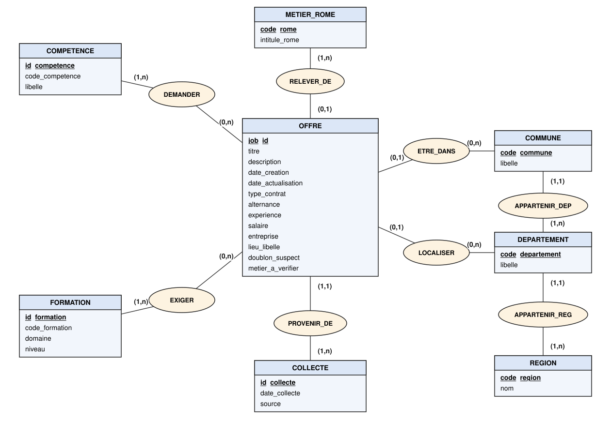

# MCD / MOD — base d'offres France Travail

Ce modèle décrit la base relationnelle construite à partir de `offres_propres.csv` (597 offres de la collecte du 31/10/2026). Les colonnes sont définies dans `dictionnaire_donnees.md`.

Le CSV est une table à plat : une ligne par offre, avec les formations et les compétences en texte JSON. Dans la base, ces valeurs multiples et les référentiels (métiers, géographie) deviennent des tables séparées.


## 1. MCD (modèle conceptuel)

### Entités

| entité      | identifiant                 | attributs                                                                                                                                                          |
|-------------|-----------------------------|--------------------------------------------------------------------------------------------------------------------------------------------------------------------|
| OFFRE       | <ins>job_id</ins>           | titre, description, date_creation, date_actualisation, type_contrat, alternance, experience, salaire, entreprise, lieu_libelle, doublon_suspect, metier_a_verifier |
| METIER_ROME | <ins>code_rome</ins>        | intitule_rome                                                                                                                                                      |
| COMMUNE     | <ins>code_commune</ins>     | libelle                                                                                                                                                            |
| DEPARTEMENT | <ins>code_departement</ins> | libelle                                                                                                                                                            |
| REGION      | <ins>code_region</ins>      | nom                                                                                                                                                                |
| COMPETENCE  | <ins>id_competence</ins>    | code_competence, libelle                                                                                                                                           |
| FORMATION   | <ins>id_formation</ins>     | code_formation, domaine, niveau                                                                                                                                    |
| COLLECTE    | <ins>id_collecte</ins>      | date_collecte, source                                                                                                                                              |

### Associations et cardinalités

| association    | côté A            | côté B            | attributs             | lecture                                                                           |
|----------------|-------------------|-------------------|-----------------------|-----------------------------------------------------------------------------------|
| RELEVER_DE     | OFFRE (0,1)       | METIER_ROME (1,n) |                       | une offre relève d'au plus un métier ROME                                         |
| ETRE_DANS      | OFFRE (0,1)       | COMMUNE (0,n)     |                       | une offre est située dans au plus une commune                                     |
| LOCALISER      | OFFRE (0,1)       | DEPARTEMENT (0,n) |                       | une offre est rattachée à au plus un département, même si sa commune est inconnue |
| APPARTENIR_DEP | COMMUNE (1,1)     | DEPARTEMENT (1,n) |                       | une commune appartient à un seul département                                      |
| APPARTENIR_REG | DEPARTEMENT (1,1) | REGION (1,n)      |                       | un département appartient à une seule région                                      |
| DEMANDER       | OFFRE (0,n)       | COMPETENCE (1,n)  | exigence              | une offre peut demander plusieurs compétences, exigées (E) ou souhaitées (S)      |
| EXIGER         | OFFRE (0,n)       | FORMATION (1,n)   | exigence, commentaire | une offre peut indiquer plusieurs formations                                      |
| PROVENIR_DE    | OFFRE (1,1)       | COLLECTE (1,n)    |                       | une offre provient d'une collecte ; une collecte ramène plusieurs offres          |

### Schéma



### Choix de modélisation

- **Entreprise** reste un attribut de OFFRE : l'API ne donne qu'un nom, absent de 200 offres, sans identifiant fiable.
- **Département relié directement à l'offre** : 42 offres ont un département sans commune connue (ex. « 75 - Paris »). Passer uniquement par la commune ferait perdre cette information.
- **Région** : elle se retrouve par le département et n'est pas stockée dans OFFRE. Les 18 offres indiquant seulement une région ou un pays étranger gardent cette information dans `lieu_libelle`.
- **Exigence sur l'association** : une même compétence peut être exigée dans une offre et seulement souhaitée dans une autre.
- **Compétence** : 88 mentions de compétences n'ont pas de code dans l'API, donc l'identifiant est créé par la base et le libellé est unique.
- **Une seule version par offre** : la base garde la version la plus récente, conformément au nettoyage. Suivre une offre sur plusieurs collectes demanderait une association plusieurs-à-plusieurs entre OFFRE et COLLECTE.
- **Hors du modèle pour l'instant** : les offres retirées, tracées dans `offres_retirees.csv`, et l'alignement avec ESCO (phase 4).


## 2. MOD (modèle organisationnel des données)

Clé primaire <ins>soulignée</ins>, clé étrangère précédée de `#`. Une clé étrangère qui fait aussi partie de la clé primaire est soulignée et précédée de `#`.

- REGION (<ins>code_region</ins>, nom)
- DEPARTEMENT (<ins>code_departement</ins>, libelle, #code_region)
- COMMUNE (<ins>code_commune</ins>, libelle, #code_departement)
- METIER_ROME (<ins>code_rome</ins>, intitule_rome)
- COLLECTE (<ins>id_collecte</ins>, date_collecte, source)
- OFFRE (<ins>job_id</ins>, titre, description, date_creation, date_actualisation, type_contrat, alternance, experience, salaire, entreprise, lieu_libelle, doublon_suspect, metier_a_verifier, #code_rome, #code_commune, #code_departement, #id_collecte)
- COMPETENCE (<ins>id_competence</ins>, code_competence, libelle)
- OFFRE_COMPETENCE (<ins>#job_id</ins>, <ins>#id_competence</ins>, exigence)
- FORMATION (<ins>id_formation</ins>, code_formation, domaine, niveau)
- OFFRE_FORMATION (<ins>#job_id</ins>, <ins>#id_formation</ins>, exigence, commentaire)

Remplissage des tables de référence :

- REGION, DEPARTEMENT et COMMUNE viennent du Code officiel géographique INSEE 2026. COMMUNE contient un seul enregistrement par code ; une commune déléguée prend le département de sa commune de rattachement.
- Le code `98818` (Nouméa, 1 offre) n'est pas dans ces tables : `code_commune` et `code_departement` restent vides pour cette offre, et `lieu_libelle` garde « 988 - Nouméa ».


## 3. Script SQL (testé sous SQLite)

```sql
CREATE TABLE region (
    code_region       TEXT PRIMARY KEY,
    nom               TEXT NOT NULL
);

CREATE TABLE departement (
    code_departement  TEXT PRIMARY KEY,
    libelle           TEXT NOT NULL,
    code_region       TEXT NOT NULL REFERENCES region(code_region)
);

CREATE TABLE commune (
    code_commune      TEXT PRIMARY KEY,
    libelle           TEXT NOT NULL,
    code_departement  TEXT NOT NULL REFERENCES departement(code_departement)
);

CREATE TABLE metier_rome (
    code_rome         TEXT PRIMARY KEY,
    intitule_rome     TEXT
);

CREATE TABLE collecte (
    id_collecte       INTEGER PRIMARY KEY,
    date_collecte     TIMESTAMP NOT NULL,
    source            TEXT NOT NULL
);

CREATE TABLE offre (
    job_id             TEXT PRIMARY KEY,
    titre              TEXT NOT NULL,
    description        TEXT NOT NULL,
    date_creation      TIMESTAMP NOT NULL,
    date_actualisation TIMESTAMP,
    type_contrat       TEXT NOT NULL CHECK (type_contrat IN ('CDI', 'CDD', 'alternance')),
    alternance         BOOLEAN,
    experience         TEXT CHECK (experience IN ('débutant', 'souhaitée', 'exigée')),
    salaire            TEXT,
    entreprise         TEXT,
    lieu_libelle       TEXT,
    doublon_suspect    BOOLEAN NOT NULL,
    metier_a_verifier  BOOLEAN NOT NULL,
    code_rome          TEXT REFERENCES metier_rome(code_rome),
    code_commune       TEXT REFERENCES commune(code_commune),
    code_departement   TEXT REFERENCES departement(code_departement),
    id_collecte        INTEGER NOT NULL REFERENCES collecte(id_collecte)
);

CREATE TABLE competence (
    id_competence     INTEGER PRIMARY KEY,
    code_competence   TEXT,
    libelle           TEXT NOT NULL UNIQUE
);

CREATE TABLE offre_competence (
    job_id            TEXT REFERENCES offre(job_id),
    id_competence     INTEGER REFERENCES competence(id_competence),
    exigence          TEXT CHECK (exigence IN ('E', 'S')),
    PRIMARY KEY (job_id, id_competence)
);

CREATE TABLE formation (
    id_formation      INTEGER PRIMARY KEY,
    code_formation    TEXT,
    domaine           TEXT,
    niveau            TEXT
);

CREATE TABLE offre_formation (
    job_id            TEXT REFERENCES offre(job_id),
    id_formation      INTEGER REFERENCES formation(id_formation),
    exigence          TEXT CHECK (exigence IN ('E', 'S')),
    commentaire       TEXT,
    PRIMARY KEY (job_id, id_formation)
);
```

Les contraintes `NOT NULL` correspondent aux colonnes obligatoires du dictionnaire, et les contraintes `CHECK` à leurs valeurs autorisées.
